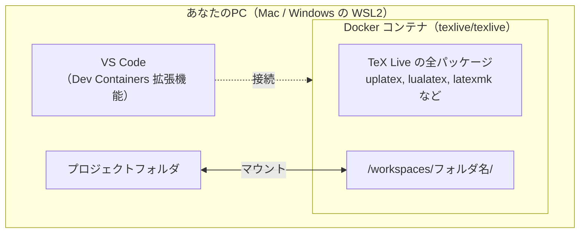

# LaTeX環境構築ガイド（Docker編）

最終更新日: 2026-10-26

PCに直接 TeX Live を入れる代わりに、**Dockerコンテナ（仮想環境）** の中に LaTeX 環境を閉じ込める方法です。Mac・Windows のどちらでも同じ手順で使えます。

> **📝 Windowsの方へ**
>
> 先に [Windows編](windows.md) の第4章で、WSL2 の有効化・Docker Desktop のインストール・WSL 側への作業フォルダの作成を済ませてください。そのあと、このページの Step 2 から進めます。

## はじめに：なぜDocker（Dev Container）なのか？

### メリット

1. **環境の統一:** MacでもWindowsでもLinuxでも、**完全に同じバージョンのTeX Live** が動作します。「先生のPCでは動くのに…」というトラブルがなくなります。
2. **汚染防止:** PC本体に数GBのソフトをインストールしません。不要になったらコンテナとイメージを削除するだけで環境が消えます。
3. **復元性:** PCを買い替えても、プロジェクトフォルダをコピーするだけで同じ環境で執筆を再開できます。

### 仕組み



- PC上のプロジェクトフォルダが、コンテナの中の `/workspaces/<フォルダ名>/` にマウント（共有）されます。
- コンパイルはコンテナの中（Linux）で行われます。
- VS Code はコンテナに接続して動くので、操作は普段の VS Code と変わりません。

## Step 1: 事前準備

以下をインストールしてください。

1. **Docker Desktop**
   * Mac: [公式サイト](https://www.docker.com/products/docker-desktop/)からダウンロード（Apple Silicon か Intel かを選ぶ）。
   * Windows: [Windows編](windows.md) の第4章の手順で入れてください（WSL2 バックエンドを使います）。
2. **VS Code**
3. **VS Code の拡張機能**

| 拡張機能名 | 説明 |
| --- | --- |
| **Dev Containers** | Dockerコンテナの中で VS Code を動かすための拡張機能（ID: `ms-vscode-remote.remote-containers`） |
| **Japanese Language Pack for Visual Studio Code** | VS Codeの日本語化（任意） |

LaTeX Workshop は、コンテナを起動したときにコンテナの中へ自動で入ります（下の `devcontainer.json` で指定しています）。手元の VS Code に入れておく必要はありません。

**動作確認:** ターミナル（Windows は PowerShell）で以下を実行し、「Hello from Docker!」と表示されれば準備完了です。

```bash
docker --version
docker run hello-world
```

## Step 2: プロジェクトフォルダを作る

レポートや論文ごとにフォルダを1つ作り、その中を以下の構成にします。

```
thesis/                      ← プロジェクトフォルダ（名前は自由。半角英数で）
├── .devcontainer/
│   └── devcontainer.json    ← Docker の設定（Step 3）
├── .latexmkrc               ← latexmk の設定（Step 4）
├── main.tex                 ← 本文（Step 4）
└── references.bib           ← 参考文献データ（必要なら）
```

* **Mac:** 好きな場所に作って構いません。ただし、パスにスペースや日本語を含めないでください（[Mac編](mac.md) 第6章のルール3）。
* **Windows:** 必ず WSL 側（`/home/ユーザー名/texwork/thesis/` など）に作ります。Windows 側（`C:\` 以下）に置くと、コンパイルが何倍も遅くなります（[Windows編](windows.md) 第4章）。

> **📝 近道**
>
> 本リポジトリの [docker_sample](../docker_sample/) フォルダが、この構成そのものです。フォルダごとコピーして名前を変えれば、Step 3・4 は済みます。

## Step 3: `.devcontainer/devcontainer.json` を作る

プロジェクトフォルダの中に `.devcontainer` フォルダを作り、その中に以下の `devcontainer.json` を作ります。これが環境の設計図です。TeX Live 公式の `texlive/texlive` イメージ（全パッケージ入り）を使うので、日本語の処理系（uplatex など）も参考文献の処理（upbibtex・biber）もすべて含まれています。

> **📝 補足：隠しフォルダ**
>
> `.` で始まるフォルダは、Finder やエクスプローラーでは普段表示されません。VS Code の中で作るのが確実です。

```jsonc
{
	"name": "LaTeX (TeX Live)",
	// TeX Live 公式イメージ（全パッケージ入り）を使用
	"image": "texlive/texlive:latest",

	"customizations": {
		"vscode": {
			// コンテナ内のVS Codeに入れる拡張機能
			"extensions": [
				"James-Yu.latex-workshop",
				"MS-CEINTL.vscode-language-pack-ja"
			],
			// コンテナ内でのVS Code設定（ローカルの設定より優先されます）
			"settings": {
				// 変更後、一定時間で自動保存し、保存をきっかけに自動ビルドを走らせる
				"files.autoSave": "afterDelay",
				"editor.wordWrap": "on",
				"latex-workshop.latex.autoBuild.run": "onSave",
				"latex-workshop.view.pdf.viewer": "tab",
				"latex-workshop.latex.autoClean.run": "onBuilt",

				// 一番上のレシピがデフォルトで実行されます
				"latex-workshop.latex.recipes": [
					{ "name": "upLaTeX", "tools": ["latexmk_uplatex"] },
					{ "name": "LuaLaTeX", "tools": ["latexmk_lualatex"] },
					{ "name": "pLaTeX", "tools": ["latexmk_platex"] },
					{ "name": "XeLaTeX", "tools": ["latexmk_xelatex"] }
				],

				// 各エンジンの細かい指定は、プロジェクト直下の .latexmkrc に任せる
				"latex-workshop.latex.tools": [
					{
						"name": "latexmk_uplatex",
						"command": "latexmk",
						"args": ["-gg", "-pdfdvi", "-outdir=%OUTDIR%", "%DOC%"]
					},
					{
						"name": "latexmk_lualatex",
						"command": "latexmk",
						"args": ["-gg", "-pdflua", "-outdir=%OUTDIR%", "%DOC%"]
					},
					{
						"name": "latexmk_platex",
						"command": "latexmk",
						"args": [
							"-gg",
							"-pdfdvi",
							"-latex=platex",
							"-synctex=1",
							"-interaction=nonstopmode",
							"-file-line-error",
							"-outdir=%OUTDIR%",
							"%DOC%"
						]
					},
					{
						"name": "latexmk_xelatex",
						"command": "latexmk",
						"args": ["-gg", "-xelatex", "-outdir=%OUTDIR%", "%DOC%"]
					}
				]
			}
		}
	},

	// ファイル権限のトラブルを防ぐ設定
	"remoteUser": "root"
}
```

### 設定項目の解説

| 設定項目 | 値 | 説明 |
| --- | --- | --- |
| `name` | `"LaTeX (TeX Live)"` | コンテナの名前。任意 |
| `image` | `"texlive/texlive:latest"` | 使用するDockerイメージ。公式のTeX Live全パッケージ版（ダウンロード約3GB。展開するとさらに大きくなる）。`latest` は常に最新の TeX Live を指す |
| `extensions` | LaTeX Workshop、日本語化 | コンテナの中のVS Codeに自動で入る拡張機能 |
| `files.autoSave` | `"afterDelay"` | 一定時間後に自動保存（既定は1秒）。`"off"` で無効化 |
| `editor.wordWrap` | `"on"` | 長い行を折り返して表示 |
| `autoBuild.run` | `"onSave"` | ファイル保存時に自動コンパイル（自動保存でも動く）。`"never"` で手動のみ |
| `view.pdf.viewer` | `"tab"` | PDFをVS Code内のタブで表示 |
| `autoClean.run` | `"onBuilt"` | コンパイルのたびに（失敗したときも）中間ファイルを削除。PDF と `.synctex.gz` は残る |
| `recipes` / `tools` | 4種類のエンジン | [Mac編](mac.md) 第4章の `settings.json` と同じ。**一番上のレシピ（upLaTeX）がデフォルト** |
| `remoteUser` | `"root"` | コンテナ内で作ったファイルの権限トラブルを防ぐ |

レシピとツールの仕組み、エンジンの切り替え方は [Mac編](mac.md) 第4章で詳しく説明しています。Docker でも同じように使えます。

## Step 4: `.latexmkrc` と `main.tex` を置く

プロジェクトフォルダの直下（`.devcontainer` の隣）に、以下の2つを置きます。

1. **.latexmkrc**
   * コンテナの中で latexmk を動かすための設定です。中身は [Mac編](mac.md) 第4章でホームディレクトリに置くものと同じです。
   * **重要:** コンテナの中からは PC のホームディレクトリにある設定が見えないため、**必ずプロジェクト直下に置いてください。**

```perl
#!/usr/bin/perl
$latex            = 'uplatex -synctex=1 -interaction=nonstopmode -file-line-error %O %S';
$lualatex         = 'lualatex -synctex=1 -interaction=nonstopmode -file-line-error %O %S';
$xelatex          = 'xelatex -synctex=1 -interaction=nonstopmode -file-line-error %O %S';
$bibtex           = 'upbibtex %O %B';
$biber            = 'biber %O --bblencoding=utf8 -u -U --output_safechars %B';
$makeindex        = 'upmendex %O -o %D %S';
$dvipdf           = 'dvipdfmx %O -o %D %S';
```

2. **main.tex**
   * 本リポジトリの [templates](../templates/) にある `main.tex`（書き始め用）をコピーします。書き方の見本は `sample.tex` です。

## Step 5: コンテナで開く

1. VS Code でプロジェクトフォルダを開きます。
   * **Mac:** 「ファイル」→「フォルダーを開く」でプロジェクトフォルダを選びます。
   * **Windows:** まず WSL 側のフォルダを開きます（[Windows編](windows.md) 第4章の「VS CodeでWSL側のフォルダを開く」）。
2. 画面右下に「コンテナーで再度開く（Reopen in Container）」という通知が出るので、クリックします。
   * 出ない場合は、左下のリモートインジケーター（`><` のアイコン）をクリックし、**「コンテナーで再度開く」** を選びます。
3. **初回のみ**、約3GBのイメージのダウンロード・展開とコンテナの作成が行われます（回線によって10〜30分程度）。
4. 起動が終わると、左下の表示が **「開発コンテナー: LaTeX (TeX Live)」**（英語表示では「Dev Container: …」）に変わります。

> **📝 補足：進捗の確認**
>
> 右下に表示される「Starting Dev Container…」をクリックすると、ログが開いて進捗を確認できます。

## Step 6: 動作確認

コンテナが起動したら、`main.tex` を開いて保存（Mac は `Cmd + S`、Windows は `Ctrl + S`）します。

1. 保存すると自動でコンパイルが始まり、左下のステータスバーに進捗が表示されます。
2. 右上の虫眼鏡アイコン（または `Cmd + Option + V` / `Ctrl + Alt + V`）でPDFを表示します。

日本語の表示まで確かめたい場合は、以下の内容で `test.tex` を作って保存してみてください。

```latex
\RequirePackage{plautopatch}
\documentclass[uplatex,dvipdfmx]{jlreq}

\usepackage{amsmath,amssymb,amsthm}
\usepackage{hyperref}
\usepackage{pxjahyper}

\newtheorem{theorem}{定理}

\title{Docker環境 動作確認}
\author{Your Name}
\date{\today}

\begin{document}
\maketitle

\section{数式のテスト}
\begin{theorem}[オイラーの公式]
任意の実数 $\theta$ に対して、
\[
    e^{i\theta} = \cos\theta + i\sin\theta
\]
が成り立つ。
\end{theorem}

\section{日本語処理のテスト}
\begin{itemize}
    \item 通常の漢字：数学、物理、化学
    \item JIS第3・第4水準：髙橋、﨑田、㈱
    \item 記号：①②③、㍻㍼㍽
\end{itemize}

\end{document}
```

> **✅ 成功の目安**
>
> - PDFが表示される
> - 日本語・数式が正しく表示される（「髙」「﨑」も出る）
> - エラーメッセージが出ない
>
> これらが確認できれば、環境構築は完了です！

## Step 7: エンジンの切り替え

* **ファイルごと:** ファイルの先頭に、使いたいレシピの名前をマジックコメントで書きます（`% !TEX program = …` はレシピを使わずエンジンを1回だけ実行するので使いません。詳しくは [Mac編](mac.md) 第4章）。

```latex
% !LW recipe = LuaLaTeX
```

* **一時的に:** VS Code 左端の **TeXアイコン** →「COMMANDS」→「Build LaTeX project」の横の矢印から、使いたいレシピを選びます。
* **デフォルトを変える:** `devcontainer.json` の `recipes` の順番を入れ替え、コンテナを作り直します（左下のリモートインジケーター →「コンテナーのリビルド」）。

## ファイルの保存場所とバックアップ

| 場所 | 説明 | 消えるか |
| --- | --- | --- |
| `/workspaces/<フォルダ名>/` | 作業フォルダ。PC上のプロジェクトフォルダがそのまま見えている | **消えない**（PC上に残る） |
| `/root/` など | コンテナ内のその他の場所 | **コンテナを削除すると消える** |

作業ファイルは必ず `/workspaces/` の下（＝PC上のプロジェクトフォルダ）に保存してください。

LaTeX のファイルはプレーンテキストなので、Git でのバージョン管理と相性が抜群です。Git を使う場合は、中間ファイルを管理対象から外す `.gitignore` をプロジェクト直下に置きます。

```
# LaTeX中間ファイル
*.aux
*.bbl
*.blg
*.log
*.out
*.toc
*.lof
*.lot
*.fls
*.fdb_latexmk
*.synctex.gz
*.dvi

# 生成されるPDF（必要に応じて）
# *.pdf
```

## 複数のプロジェクトを管理する

プロジェクトごとに `.devcontainer/` を置けば、それぞれが独立したコンテナで動きます。イメージ（`texlive/texlive`）は共通なので、ダウンロードは最初の1回だけです。

```
texwork/
├── thesis/              ← 卒論・修論
│   ├── .devcontainer/
│   ├── .latexmkrc
│   ├── main.tex
│   └── chapters/
├── report/              ← 授業レポート
│   ├── .devcontainer/
│   ├── .latexmkrc
│   └── main.tex
└── slides/              ← 発表スライド
    ├── .devcontainer/
    ├── .latexmkrc
    └── slides.tex
```

## トラブルシューティング

### 「コンテナーで再度開く」が表示されない

**原因：** Dev Containers 拡張機能が入っていない、または無効になっている

**対処：**
1. 拡張機能タブで「Dev Containers」を検索し、インストール（または有効化）する
2. VS Codeを再起動する
3. プロジェクトフォルダの直下に `.devcontainer/devcontainer.json` があるか確認する（フォルダ名の先頭のドットを忘れやすい）

### 初回の起動がすごく遅い / 途中で止まる

**原因：** 約3GBのイメージをダウンロードして展開しているため。途中で止まる場合は、ネットワークの問題かダウンロードの失敗

**対処：**
1. 初回は10〜30分かかるのが普通です。2回目以降は数秒で起動します
2. 止まった場合は Docker Desktop を再起動し、ターミナルで以下を実行してイメージを手動で取得してから、もう一度「コンテナーで再度開く」を実行します

```bash
docker pull texlive/texlive:latest
```

### コンパイルが「Recipe terminated with error」で失敗する

**原因：** TeXファイルの文法エラー、またはレシピとファイルの不一致

**対処：**
1. 「出力」パネル（Mac は `Cmd + Shift + U`、Windows は `Ctrl + Shift + U`）で「LaTeX Compiler」を選び、エラーメッセージを確認する
2. よくあるエラー：
   - `Undefined control sequence` → コマンドのスペルミス、またはパッケージの読み込み忘れ
   - `Missing $ inserted` → 数式モードの閉じ忘れ
   - `! LaTeX Error: Missing \begin{document}` → プリアンブルの構文エラー
3. 日本語が文字化けする・通らない場合は、文書クラスとエンジンが合っているか確認する
   - upLaTeX：`\documentclass[uplatex,dvipdfmx]{jlreq}`
   - LuaLaTeX：`\documentclass{jlreq}`（`% !LW recipe = LuaLaTeX` を先頭に）

### 必要なパッケージがないと言われる

`texlive/texlive` は全パッケージ入りなので、通常は起きません。`File 'xxx.sty' not found` と出た場合は、まずパッケージ名のスペルミスを疑ってください。TeX Live に含まれていない独自のスタイルファイル（学会配布のものなど）は、`.tex` と同じフォルダに置けば読み込まれます。

### PDFが表示されない / 真っ白

**対処：**
1. まずコンパイルが成功しているか（`main.pdf` ができているか）を確認する
2. TeXアイコンのサイドバー →「View LaTeX PDF」をクリックする
3. それでも表示されない場合は、`main.pdf` を Finder / エクスプローラーから直接開いて確認する

### コンテナやイメージを削除したい

Docker Desktop の「Containers」タブから該当するコンテナを削除します。さらに容量を空けたい場合は「Images」から `texlive/texlive` を削除するか、ターミナルで以下を実行します（使っていないイメージとコンテナがまとめて消えます）。

```bash
docker system prune -a
```

### Windowsで動作が重い

プロジェクトを Windows 側（`C:\` 以下）に置いていないか確認してください。WSL 側に置くことと、WSL2 へのメモリ割り当ては [Windows編](windows.md) の付録 A.2 で説明しています。

## 参考リンク

- **texlive/texlive Dockerイメージ**: [https://hub.docker.com/r/texlive/texlive](https://hub.docker.com/r/texlive/texlive)
- **Docker Desktop**: [https://www.docker.com/products/docker-desktop/](https://www.docker.com/products/docker-desktop/)
- **Dev Containers拡張機能**: [https://marketplace.visualstudio.com/items?itemName=ms-vscode-remote.remote-containers](https://marketplace.visualstudio.com/items?itemName=ms-vscode-remote.remote-containers)
- **LaTeX Workshop拡張機能**: [https://marketplace.visualstudio.com/items?itemName=James-Yu.latex-workshop](https://marketplace.visualstudio.com/items?itemName=James-Yu.latex-workshop)
