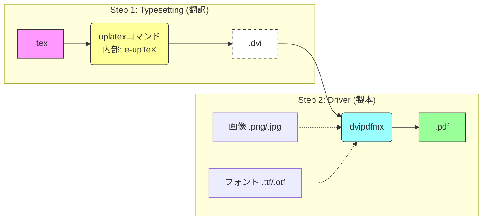
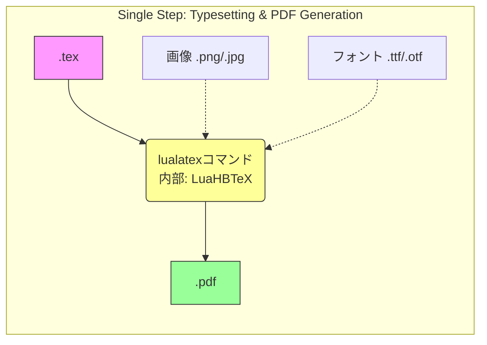

# LaTeX処理系の仕組みと現在の「標準」

最終更新日: 2026-10-06

## 1. はじめに：LaTeXは「魔法の箱」ではない

多くの初心者は、LaTeXを「テキストを入れるとPDFが出てくる魔法の箱」だと思っています。しかし実際には、**複数のプログラムが連携して動く「工場（パイプライン）」** です。

この仕組みを知らないと、「ネットの古い記事をコピペしたら動かなくなった」「画像が出ない」といったトラブルに自力で対処できません。本資料では、その工場の内部構造を解説します。

## 2. 各エンジンの詳細な処理経路（パイプライン）

LaTeXには大きく分けて、**「DVI（中間ファイル）を経由するルート」** と **「PDFを直接出力するルート」** の2種類があります。それぞれの内部で何が起きているのかを見てみましょう。

### Type A: DVIを経由するルート (uplatex, platex)

日本で長年使われてきた伝統的な方式です。本講義で採用している uplatex もこちらに分類されます。



* **処理の特徴:**  
  1. **Engine (e-upTeX):** ソースコードを読み、文字の配置情報だけが書かれた DVI ファイルを出力します。この時点では**画像の実体やフォントデータは含まれていません**。  
  2. **Driver (dvipdfmx):** DVI を読み込み、ここで初めて画像ファイルやフォントを結合して PDF を作成します。  
* **注意点:** エンジンとドライバが分かれているため、両者の連携（ドライバ指定）を間違えるとエラーになります。

### Type B: PDFを直接出力するルート (lualatex, pdflatex)

欧米での標準（pdflatex）や、最新のモダンな方式（lualatex）です。



* **処理の特徴:**  
  * 中間ファイル（DVI）を作らず、エンジンが直接 PDF を書き出します。  
  * **Engine (LuaHBTeX):** 内部で Lua 言語や HarfBuzz（文字描画エンジン）を利用し、高度なフォント処理を行いながら PDF を生成します。  
* **メリット:** ドライバの指定忘れによるトラブルが起きません。

## 3. なぜ「uplatex」なのか？ (詳細比較)

日本には歴史的な経緯により、複数のエンジンが存在します。それぞれの内部動作と採用理由を整理します。

| コマンド名 | 内部エンジン | 出力形式 | 特徴と採用可否 |
| :---- | :---- | :---- | :---- |
| **platex** | e-pTeX | .dvi | **× 非推奨 (Legacy)** 1990年代からの標準。文字コード処理が古く（Shift-JISベース）、**「髙」や「森鷗外」などのUnicode文字を直接扱えません**。 |
| **uplatex** | e-upTeX | .dvi | **◎ 推奨 (Standard)** platex の内部をUnicode対応に拡張したもの。従来の資産（古いスタイルファイル等）との互換性を保ちつつ、現代の文字環境に対応した**「数理系の最適解」**です。 |
| lualatex | LuaHBTeX | .pdf | △ サブ (Modern) 最も先進的ですが、計算処理が複雑なため uplatex に比べてコンパイル時間が長くなる傾向があります。 |
| pdflatex | pdfTeX | .pdf | × 非推奨 (Western) 欧米の標準ですが、そのままでは**日本語が通らない**ため、国内のレポート作成には向きません。 |

## 4. 陥りやすい罠：ドライバの混在

Type A（DVIルート）を使う場合、最も多いトラブルが「ドライバの指定ミス」です。

### 悪い例：ドライバの競合

ネット上の古い記事（2010年頃など）を参考にすると、以下のような記述を見かけることがあります。

```latex
% 【悪い例】絶対にやってはいけない記述
\usepackage[dvips]{graphicx}    % 古い印刷用ドライバ
\usepackage[dvipdfmx]{color}    % PDF変換用ドライバ
```

dvips は DVI を **PostScript** という古い形式に変換するためのドライバです。これを dvipdfmx と混ぜると、LaTeXは**「PostScriptを作りたいの？ PDFを作りたいの？」と混乱し、画像のズレや消失を引き起こします。**

### 正しい記述 (2025年版)

ドキュメントクラス（1行目）でグローバルに指定すれば、すべてのパッケージがそれを継承します。

```latex
% 【良い例】1行目で宣言し、あとは書かない
\documentclass[uplatex,dvipdfmx]{jlreq}

\usepackage{graphicx} % 自動的に dvipdfmx オプションが適用される
\usepackage{color}    % 同上
```

## 5. ドキュメントクラス：jlreq vs jsarticle

| | **jsarticle（jsclasses）** | **jlreq** |
| :---- | :---- | :---- |
| **歴史** | 奥村晴彦氏による古くからの定番。実績・情報量が豊富。 | jsarticleより後発で、開発が活発に続いている。 |
| **仕様の根拠** | 独自の設計（JIS規格を直接参照したものではない） | 「日本語組版処理の要件 (JLREQ)」というW3C技術ノートに準拠して設計 |
| **カスタマイズ性** | オプションは少なめで、比較的固定的なレイアウト | 行長・字下げ・見出しデザインなどを柔軟に調整できるオプションが豊富 |
| **採用可否** | ◎ 今でも十分使えるが、新しい組版機能は少ない | ◎ 本講義採用。柔軟性が高く、現代的な組版要件に対応しやすい |

数理系の論文、書籍、レポートなど、あらゆる用途に対応できる柔軟性を重視し、本講義では jlreq を採用しています。

## 6. なぜ「何回もコンパイル」が必要なのか？

LaTeXを使っていると、「1回コンパイルしただけでは図表番号が ?? になる」という現象に出会います。これはバグではなく仕様です。

### LaTeXの読み書きの仕組み

LaTeXは、ソースコードを**上から下へ一回しか読みません**。

1. **1回目のコンパイル:**  
   * 本文中の \\label{eq:1}（数式番号の定義）を見つけると、「eq:1 は 1ページ目の 式番号(1) だな」とメモ帳（**.aux ファイル**）に書き込みます。  
   * この時点では、前の方に出てきた \\ref{eq:1}（参照）はまだ答えを知らないので ?? と表示します。  
2. **2回目のコンパイル:**  
   * 最初に .aux ファイル（前回のメモ）を読み込みます。  
   * 「eq:1 は (1) だ」と知った状態で本文を処理するため、\\ref{eq:1} が正しく (1) に置き換わります。

### 自動化ツール latexmk

人間が「あ、?? があるからもう一回コンパイルしなきゃ」と判断するのは時間の無駄です。  
latexmk は、.aux ファイルなどの変化を監視し、「結果が変わらなくなるまで（収束するまで）」自動でコンパイルを繰り返してくれるツールです。

## 7. 文献管理：BibTeX vs Biber

論文で必須となる「参考文献」の処理も、専用のプログラムが行います。

* **BibTeX / pBibTeX (旧):**  
  * 非常に古くからあるが、URLの表示やUnicode（日本語）の並び替えが苦手。  
* **Biber (新):**  
  * **biblatex** パッケージとセットで使う最新のプログラム。  
  * Unicode完全対応。URLやDOIの処理も簡単。  
  * 本講義のサンプルファイルではこちらを採用しています。

## 8. 参考文献・リンク

本資料作成にあたり、以下のWebサイトを参考にしました。より詳細な情報はリンク先をご参照ください。

* **wtsnjp: 日本語LaTeXの新常識2021**  
  * https://qiita.com/wtsnjp/items/76557b1598445a1fc9da  
  * plautopatchの読み込み、DVIドライバのクラスオプション指定、jlreqなど文書クラスの選択肢について解説した記事です（latexmkは扱っていません）。  
* **yyu: TeX処理系御伽話**  
  * https://qiita.com/yyu/items/6404656f822ce14db935  
  * 各エンジンの内部構造やパイプラインの違いについて、非常に詳しく解説されています。