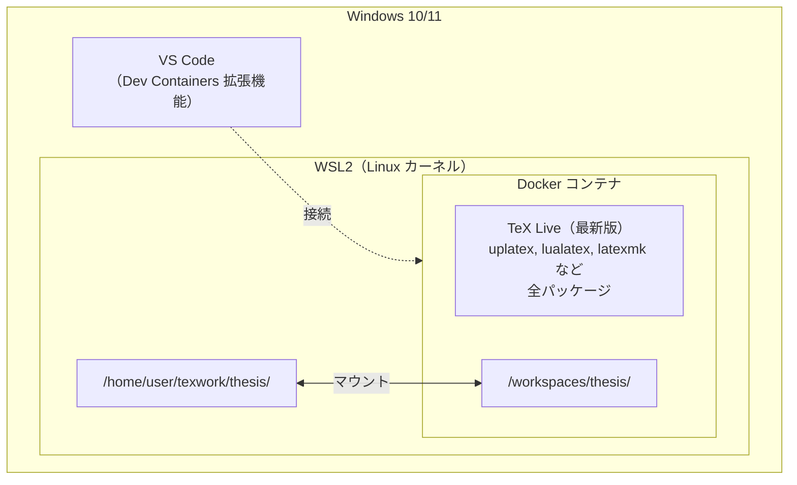

# 数学科大学院生のためのLaTeX完全ガイド (Windows編)

最終更新日: 2026-10-26

> **本資料の想定環境**
>
> - Windows 10 / 11（64bit）
> - TeX Live 2026
> - VS Code / TeXworks
>
> LaTeXのエコシステムは進化が速いため、数年後に読む場合は最新情報を確認してください。

---

## まえがき

本ガイドは、[Mac編](mac.md)の姉妹編として、Windows環境でLaTeXを使いたい数学科大学院生向けに執筆しました。

最初にお伝えしておくと、**WindowsでのLaTeX環境構築には、Macにはない落とし穴がいくつかあります**（日本語のユーザー名、OneDrive、文字コードなど）。ただし、どれも原因が分かっていて、避け方もあります。

本ガイドでは、Windowsで快適にLaTeXを使うための3つの方法を紹介します。

1. **クラウドサービスを使う（最も簡単）** → 環境構築不要
2. **TeX Live + TeXworksを使う（簡易版）** → 動くが遅い
3. **Docker + VS Codeを使う（本格版）** → Mac同等の快適さ

> **本ガイドの想定読者**
>
> - Windows PCしか持っていないが、LaTeXを使わなければならない方
> - 過去にTeX Liveのインストールで挫折した経験のある方
> - 「なぜWindowsだとうまくいかないのか」を理解したい方
>
> 手早く始めたい方は、環境構築のいらないクラウドサービス（第3章）から始めるのもおすすめです。

---

# 目次

1. **第1章 はじめに：LaTeXとは？**（Mac編と共通）
2. **第2章 Windowsで起きやすい問題**
3. **第3章 それでもWindowsで始める方へ**
    - 3.1 最も簡単な方法：クラウドサービス
    - 3.2 ローカル環境（簡易版）：TeX Live + TeXworks
4. **第4章 本格的な環境構築（Docker + VS Code）**
5. **第5章 理論：TeXエンジンの進化と日本語処理の仕組み**（Mac編と共通）
6. **第6章 ルール：LaTeXの「新常識」とトラブルシューティング**（Mac編と共通）
7. **第7章 技術：論文執筆を加速するプロの技**（Mac編と共通）
8. **付録**

---

# 第1章 はじめに：LaTeXとは？

> **📝 この章について**
>
> 本章の内容はMac編と共通です。LaTeXの基本思想、Word vs LaTeXの比較、LaTeXを学ぶべき理由については、[Mac編](mac.md)の第1章を参照してください。

---

# 第2章 Windowsで起きやすい問題

本章では、WindowsでLaTeXを使う際に直面する**構造的な問題**を、技術的な観点から体系的に解説します。

「なぜWindowsだと難しいのか」を理解しておくと、トラブルに遭遇した際の対処が容易になります。第3章以降で紹介する方法が、なぜその形になっているのかも分かります。

## 2.1 本章の前提環境

本章では、以下の環境を前提とします。

- **OS:** Windows 10 / 11（64bit、NTFS）
- **エディション:** Home / Pro（共通の挙動のみ扱う）
- **アカウント:** Microsoftアカウントを用いた標準セットアップ

特定バージョン固有の問題については、その都度明記します。

---

## 2.2 パスとファイルシステムに起因する問題

WindowsのファイルシステムとTeX Live（Unix由来）の相性問題は、最も深刻なトラブル原因です。

### 2.2.1 日本語ユーザー名・日本語パス

**現象:**
Microsoftアカウントでサインインした場合、ユーザーフォルダが日本語名になることがあります。

```
C:\Users\山田太郎\
```

このパスを含む環境でTeX Liveをインストールすると、以下のようなエラーが発生します。

```
open(>C:\Users\\x{0082}a\x{0082}\x{00a4}...\AppData\Local\Temp\...)
failed: No such file or directory
```

**原因:**
TeX Liveの内部処理（Perl）が、マルチバイト文字を正しく処理できないことがあります。特に `%TEMP%` や `%TMP%` 環境変数がユーザーフォルダを参照するため、一時ファイルの作成に失敗します。

**影響:**
- TeX Liveのインストールが途中で停止する
- インストール後も、パッケージ更新やフォントキャッシュ生成で問題が発生する可能性がある

**回避策:**

| 方法 | 手順 | 推奨度 |
| --- | --- | --- |
| 環境変数の変更 | `TEMP`/`TMP` を `C:\temp` に設定 | △（他アプリへの影響あり） |
| ローカルアカウント作成 | 半角英数字のみのユーザーを追加 | ○（確実だが切替が面倒） |
| ポータブルインストール | `C:\texlive\` に直接インストール | ○（環境変数の手動設定が必要） |

### 2.2.2 OneDrive同期フォルダ

**現象:**
Windows 10/11では、以下のフォルダがOneDriveと自動同期される設定がデフォルトになっている場合があります。

- デスクトップ → `C:\Users\<ユーザー名>\OneDrive\Desktop\`
- ドキュメント → `C:\Users\<ユーザー名>\OneDrive\Documents\`
- ダウンロード → `C:\Users\<ユーザー名>\OneDrive\Downloads\`（設定による）

**原因:**
OneDriveの「重要なフォルダーの保護（バックアップ）」機能が有効になっています。

**影響:**
- パスに日本語（「ドキュメント」等）が含まれる可能性がある
- コンパイル中に `.aux`、`.log` などの中間ファイルがOneDriveにより同期され、ファイルロックが発生する
- 大量の中間ファイルがクラウドストレージを圧迫する

**回避策:**
- OneDriveの「重要なフォルダーをバックアップ」設定をオフにする
- LaTeX作業用フォルダを `C:\texwork\` などOneDrive外に作成する

### 2.2.3 パス長制限（MAX_PATH）

**現象:**
ファイルパスが260文字を超えると、ファイルの作成・読み取りに失敗することがあります。

**原因:**
Win32 APIの仕様により、ファイルパスの最大長がデフォルトで260文字に制限されています。TeX Liveは深いディレクトリ構造を持つため、以下のようなパスが生成されます。

```
C:\texlive\2026\texmf-dist\tex\latex\l3packages\xparse\xparse.sty
```

これに日本語プロジェクト名や深いフォルダ階層が加わると、制限を超える可能性があります。

**回避策:**
- Windows 10（バージョン1607以降）で `LongPathsEnabled` を有効化する
- 作業フォルダをルートに近い場所（`C:\tex\` など）に配置する

---

## 2.3 シェル・文字コードに起因する問題

### 2.3.1 PowerShellと文字コード

**現象:**
PowerShellでLaTeXのエラーメッセージを表示すると、日本語が文字化けします。

**原因:**
Windows PowerShell 5.x のデフォルト出力エンコーディングはShift-JIS（CP932）ですが、TeX Liveの出力はUTF-8です。

**影響:**
- エラーメッセージが読めず、デバッグが困難になる
- スクリプトでファイルを生成すると、文字コードが混在する

**回避策:**

一時的な対処（セッションごとに実行）:

```powershell
[Console]::OutputEncoding = [System.Text.Encoding]::UTF8
$OutputEncoding = [System.Text.Encoding]::UTF8
```

恒久的な対処:
- PowerShellプロファイル（`$PROFILE`）に上記を追記する
- Windows Terminal + PowerShell 7 を使用する（デフォルトがUTF-8）

### 2.3.2 シェル環境の多様性

**現象:**
同じコマンドを実行しても、使用するシェルによって結果が異なることがあります。

**原因:**
Windows環境では、以下のシェルが共存しうる状態にあります。

| シェル | 特徴 |
| --- | --- |
| cmd.exe | 従来のコマンドプロンプト |
| PowerShell 5.x | Windows標準（Shift-JIS） |
| PowerShell 7.x | クロスプラットフォーム版（UTF-8） |
| Git Bash | Git for Windows付属のBashシェル |
| WSL | Windows Subsystem for Linux |

**影響:**
- ネット上の解説記事やスクリプトが、どのシェルを前提としているか不明確な場合がある
- シェルごとにパス区切り文字（`\` vs `/`）、環境変数の参照方法（`%VAR%` vs `$VAR`）が異なる

**回避策:**
- 使用するシェルを統一し、そのシェル用の手順を参照する
- 本ガイドのDocker環境では、Linux（Bash）に統一することでこの問題を回避する

---

## 2.4 セキュリティ・運用まわりの問題

### 2.4.1 ウイルス対策ソフトによる干渉

**現象:**
- TeX Liveインストーラー実行時に「Windows によって PC が保護されました」と警告が表示される
- コンパイルが異常に遅い
- 一部の実行ファイルが隔離される

**原因:**
Windows DefenderやサードパーティのウイルスソフトがTeX Liveの実行ファイルをスキャン対象としています。

**影響:**
- インストールが中断される
- リアルタイムスキャンにより、コンパイル時の大量のファイルI/Oが遅延する

**回避策:**
- インストール時に「詳細情報」→「実行」を選択する
- TeX Liveインストールフォルダ（`C:\texlive\`）をスキャン除外に追加する

### 2.4.2 自動アップデートと環境の変化

**現象:**
ある日突然、それまで動いていたコンパイルが失敗する、または極端に遅くなる。

**原因:**
- Windows Updateによるシステム変更
- ドライバの自動更新
- ウイルス定義ファイルの更新によるスキャン動作の変化

**影響:**
- 長期的に再現可能なビルド環境の維持が困難
- 研究室の共用PCでは、管理者による設定変更でDocker/WSLの利用が制限されることがある

**回避策:**
- Docker環境を使用し、ビルド環境をコンテナ内に隔離する
- 重要な締め切り前には、Windows Updateを一時的に延期する

---

## 2.5 Unix系ツールとの非互換性

### 2.5.1 Unix前提のツールチェーン

**現象:**
LaTeX関連の解説記事やスクリプトが、そのままWindowsで動作しない。

**原因:**`latexmk`、`Makefile`、シェルスクリプトなど、LaTeXまわりのツールチェーンの多くはUnix環境を前提に設計されています。

**影響:**
- 改行コード（LF vs CRLF）の違いでスクリプトが動作しない
- パス区切り文字（`/` vs `\`）の違いでファイルが見つからない
- シェルコマンド（`rm`、`cp`、`mkdir -p` など）がそのまま使えない

### 2.5.2 Unix互換レイヤーの乱立

**現象:**
複数のUnix互換環境をインストールした結果、どの `perl` や `tar` が使われているか分からなくなる。

**原因:**
Windows上でUnixライクな環境を提供するソフトウェアが複数存在します。

| 環境 | 提供元 | 特徴 |
| --- | --- | --- |
| Cygwin | Cygwin Project | 完全なPOSIX互換環境 |
| MSYS2 | MSYS2 Project | MinGWベースの開発環境 |
| Git Bash | Git for Windows | Git操作用の軽量Bash |
| WSL | Microsoft | 本格的なLinuxカーネル |

**影響:**
- 環境変数PATHの競合により、TeX Liveが想定外のツールを呼び出す
- 典型的なエラー: `TLPDB::_install_data: untar failed for ...`

**回避策:**
- 使用する環境を1つに絞り、他の環境はPATHから除外する
- 本ガイドでは、Docker（WSL2バックエンド）に統一することを推奨する

---

## 2.6 教育・運用コストに関する問題

### 2.6.1 ドキュメントとサンプルコードの前提環境

**現象:**
インターネット上のLaTeX解説記事や、教員・先輩から共有されたセットアップ手順が、そのまま動作しない。

**原因:**
LaTeX、数値計算、プログラミング関連の教材やブログ記事の多くは、macOSまたはLinuxを前提に書かれています。

**影響:**
- パスの書き方、コマンドの違いを自力で補正する必要がある
- 「同じ手順をたどっているはずなのに動かない」状況が発生しやすい

### 2.6.2 サポート・トラブルシューティングの難しさ

**現象:**
指導教員や先輩に質問しても、「自分の環境（Mac/Linux）では再現しない」と言われる。

**原因:**
Windows固有の問題（日本語パス、OneDrive同期、PATH競合など）は、Mac/Linux環境では発生しません。

**影響:**
- トラブルシューティングに追加の時間がかかる
- 質問する際に、Windows固有の環境情報を毎回説明する必要がある

---

## 2.7 まとめ：Windowsの構造的制約

以下の表に、本章で説明した問題を整理します。

| カテゴリ | 問題 | 原因 | 深刻度 |
| --- | --- | --- | --- |
| **パス・ファイルシステム** | 日本語ユーザー名 | Microsoftアカウント連携 | ★★★★★ |
|  | OneDrive同期 | デフォルト設定 | ★★★★☆ |
|  | パス長制限 | Win32 APIの仕様 | ★★☆☆☆ |
| **シェル・文字コード** | PowerShell文字コード | 歴史的経緯（Shift-JIS） | ★★★☆☆ |
|  | シェル環境の多様性 | 複数シェルの共存 | ★★☆☆☆ |
| **セキュリティ・運用** | ウイルス対策干渉 | セキュリティ機能 | ★★★☆☆ |
|  | 自動アップデート | Windows Update等 | ★★☆☆☆ |
| **Unix非互換** | ツールチェーン非互換 | POSIX前提の設計 | ★★★☆☆ |
|  | Unix互換レイヤー乱立 | 複数環境の共存 | ★★★☆☆ |
| **教育・サポート** | 教材との不整合 | Mac/Linux前提の解説 | ★★☆☆☆ |
|  | サポートの難しさ | 環境差による再現困難 | ★★☆☆☆ |

---

> **📝 この先の進み方**
>
> 上記の問題の多くは、Windowsの「仕様」に起因するものです。そのため本ガイドでは、問題を一つずつ潰すのではなく、問題が起きない環境を選ぶことをおすすめします。
>
> - **すぐに書き始めたい** → クラウドサービス（第3章 3.1）
> - **手元で手軽に動かしたい** → TeX Live + TeXworks（第3章 3.2）
> - **手元で本格的に使いたい** → Docker + VS Code（第4章）。上記の問題を**すべて回避**できます

---

# 第3章 それでもWindowsで始める方へ

第2章の内容を踏まえて（あるいは勇気を持って読み飛ばして）ここに辿り着いた方へ。

本章では、**現実的な選択肢**を難易度順に紹介します。

## 3.1 最も簡単な方法：クラウドサービス

環境構築の苦労から完全に解放される方法があります。**クラウドLaTeXサービス**を使えば、ブラウザだけでLaTeXが使えます。

### Overleaf（オーバーリーフ）

**URL:** [https://www.overleaf.com/](https://www.overleaf.com/)

世界で最も利用されているクラウドLaTeXサービスです。

**メリット：**
- 環境構築が完全に不要
- 共同編集機能が充実（Google Docsのように複数人で同時編集可能）
- 豊富なテンプレート（学会テンプレートも多数）
- 日本語も問題なく使える

**デメリット：**
- 無料プランではコンパイル時間に制限あり（20秒）
- オフラインでは使えない
- 大規模なプロジェクトには不向き

### Cloud LaTeX（クラウドラテフ）

**URL:** [https://cloudlatex.io/](https://cloudlatex.io/)

日本発のクラウドLaTeXサービスです。

**メリット：**
- 日本語環境に最適化されている
- 科研費テンプレートなど、日本特有のテンプレートが充実
- 国内サーバーで比較的高速

**デメリット：**
- Overleafに比べると機能が限定的
- ユーザー数が少なく、情報が少ない

> **📝 推奨**
>
> 卒論・修論レベルの文書であれば、**Overleaf**で十分対応できます。
>
> 「環境構築に時間を使いたくない」「共同作業が多い」という方は、クラウドサービスで十分です。ローカル環境は、必要になったときに改めて作れば構いません。

---

## 3.2 ローカル環境（簡易版）：TeX Live + TeXworks

「どうしてもローカルに環境を作りたい」という方向けの、最も標準的な方法です。

### 前提条件の確認

インストールを始める前に、以下を確認してください。

### ✅ チェックリスト

| 項目 | 確認方法 | 問題がある場合 |
| --- | --- | --- |
| ユーザー名が半角英数字か | `C:\Users\` フォルダを確認 | 第2章の回避策を参照 |
| OneDrive同期が無効か | デスクトップ等のパスを確認 | 同期をオフにする |
| 空き容量が15GB以上あるか | エクスプローラーでCドライブを確認 | 不要ファイルを削除 |
| 管理者権限があるか | 設定 → アカウントを確認 | 管理者に相談 |

### インストール手順

TeX Liveのインストール方法は、**TeX Wiki**に非常に詳しく解説されています。本ガイドでは概要のみを説明し、詳細はTeX Wikiを参照してください。

### 参照すべきページ

- **TeX Wiki - Microsoft Windows:** [https://texwiki.texjp.org/?Microsoft%20Windows](https://texwiki.texjp.org/?Microsoft%20Windows)
- **TeX Wiki - TeX Live/Windows:** [https://texwiki.texjp.org/?TeX%20Live%2FWindows](https://texwiki.texjp.org/?TeX%20Live%2FWindows)

### 手順の概要

1. **TeX Live インストーラーのダウンロード**
    - [https://www.tug.org/texlive/acquire-netinstall.html](https://www.tug.org/texlive/acquire-netinstall.html) から `install-tl-windows.exe` をダウンロード
    - または、ISOイメージをダウンロード（回線が不安定な場合に推奨）
2. **インストーラーの実行**
    - ダウンロードした `install-tl-windows.exe` を**右クリック → 管理者として実行**
    - 「Windows によって PC が保護されました」と表示されたら、「詳細情報」→「実行」を選択
3. **インストールオプションの設定**
    - 「Install」にチェックが入っていることを確認
    - 「TeXworks をインストール」にチェックが入っていることを確認
    - 「デフォルト用紙サイズ」を「A4」に変更
4. **インストールの実行**
    - 「インストール」をクリック
    - **1〜2時間程度**かかります。気長に待ちましょう。
5. **TeXworksのタイプセット方式をupLaTeXにする**
    - スタートメニューから「TeX Live 2026」（インストールした年度）→「TeXworks editor」を起動
    - メニューの「編集」→「設定」→「タイプセット」タブを開き、「デフォルト」を **「upLaTeX (ptex2pdf)」** にする
    - 候補に「upLaTeX (ptex2pdf)」が無い場合は、管理者権限のPowerShellで `tlmgr postaction install script ptex2pdf` を実行してから設定を開き直す（それでも出ない場合の手動登録は[クイックスタート](quickstart.md)の「TeXworksを使う場合」を参照）
    - 設定後、TeXworksをいったん閉じて開き直す

> ⚠️ この設定を飛ばすと、日本語に対応していない方式（pdfLaTeXなど）でコンパイルされ、日本語の文書はエラーになります。

6. **動作確認**
    - 以下のサンプルコードを入力し、タイプセット方式が「upLaTeX (ptex2pdf)」になっていることを確認してから、緑の再生ボタン（タイプセット）をクリック

```latex
\RequirePackage{plautopatch}
\documentclass[uplatex,dvipdfmx]{jlreq}
\begin{document}
Hello, \LaTeX!

これは日本語のテストです。
\end{document}
```

PDFが表示されれば成功です。

> **⚠️ インストールに失敗した場合**
>
> 日本語ユーザー名が原因である可能性が高いです。第2章の回避策を試すか、クラウドサービスの利用を検討してください。
>
> また、[TeX フォーラム](https://okumuralab.org/tex/) で質問すると、経験豊富なユーザーからアドバイスを得られることがあります。

### TeXworksの限界

TeXworksは軽量で使いやすいエディタですが、以下の限界があります。

- **コンパイルが遅い**（特にLuaLaTeX）
- **機能が限定的**（コード補完、エラーハイライトなどが弱い）
- **カスタマイズ性が低い**

「とりあえず動く環境」としては十分ですが、本格的に論文を書くには物足りなく感じるでしょう。

より快適な環境を求める方は、次章の「Docker + VS Code」へ進んでください。

### TeXworksの既知の問題：複数ウィンドウ起動時のエラー

> ⚠️ 既知の挙動（TeX Live 2023〜2025）

Windows環境において、TeXworksを起動した状態で**エクスプローラーから別の `.tex` ファイルをダブルクリックして開こうとすると**、以下のようなエラーメッセージがポップアップ表示される場合があります。

```
Error：
C:\texlive\2025\bin\windows\runscript.tlu:922: command failed with exit code 60881876:
texworks "ファイルパス"
```

（行番号やエラーコードは環境により異なります）

### この問題の特徴

- TeXworks内の「ファイル」メニューからファイルを開いた場合には**発生しない**
- ポップアップを閉じると、その後は**通常通り編集・コンパイルが可能**
- ファイルやLaTeX処理自体が壊れるわけではない
- 致命的ではないが、初心者を混乱させやすい

### 原因と修正状況

TeXworksのプロセス間通信（別インスタンスがファイルを既存インスタンスに渡す際の終了コード処理）に起因する不具合です。[TeXworks GitHub Issue #1093](https://github.com/TeXworks/texworks/issues/1093) として2025年12月8日に報告され、**同年12月18日に修正済み**（closed: completed）としてクローズされています。

この修正は TeXworks 0.6.11（TeX Live 2026 に同梱）のリリースノートに「Fix exit code when transferring to other instance」として載っています。TeX Live 2025 に同梱の TeXworks 0.6.10 以前では現象が発生します。TeX Live 2025 を使い続けている場合は、TeX Live 2026 に入れ替えるか、以下の回避策を使ってください。

### 回避策

- TeXworks起動後は、**「ファイル」メニューからファイルを開く**
- エクスプローラーからの`.tex`ファイルのダブルクリックは避ける
- 複数ファイルを扱う場合は、**VS Code等の別エディタを推奨**

### TeX Liveの更新（tlmgr）

TeX Liveは定期的に更新されます。パッケージの更新は `tlmgr`（TeX Live Manager）コマンドで行います。

**PowerShell（管理者として実行）で以下を実行：**

```powershell
# tlmgr自体を最新に更新
tlmgr update --self

# 全パッケージを更新
tlmgr update --all
```

> **📝 補足：更新頻度**
>
> 通常は月に1回程度の更新で十分です。論文提出直前など重要な作業前は、環境を変更しないことを推奨します。

> **⚠️ 新しい年度版への移行について**
>
> TeX Liveは毎年3月頃に新バージョンがリリースされます。年度をまたぐ移行（例：TeX Live 2026 → 2027）は、`tlmgr`では行えません。
>
> 新バージョンへの移行方法：
> 1. 旧バージョン（例：2026）をアンインストール
> 2. 新バージョン（例：2027）を新規インストール
>
> 論文執筆中など重要な作業中は、安定性を優先して旧バージョンを継続使用することを推奨します。新バージョンのリリース直後は、パッケージの互換性問題が発生する可能性があります。

---

# 第4章 本格的な環境構築（Docker + VS Code）

> **この章について**
>
> 本章は、**コマンドライン操作に抵抗がない方**、**将来的にプログラミングやサーバー管理にも興味がある方**向けの内容です。
>
> 「理系の大学院生なのだから、Dockerくらい使えるようになっておこう」という考えのもと、本格的な環境構築を解説します。

## 4.1 なぜDockerなのか？

第2章で説明した通り、Windowsには多くの構造的問題があります。これらを**すべて回避**する方法が、**Docker**です。

Dockerは、**仮想的なLinux環境**をWindows上に構築する技術です。LaTeXのコンパイルはこのLinux環境内で行われるため、Windowsの問題（日本語パス、文字コード、環境変数など）の影響を受けません。

| 方式 | 日本語パス問題 | 文字コード問題 | 環境変数問題 | コンパイル速度 |
| --- | --- | --- | --- | --- |
| TeX Live + TeXworks | 影響大 | 影響あり | 影響あり | 遅い |
| Docker + VS Code | **影響なし** | **影響なし** | **影響なし** | **高速** |

### Dockerの仕組み（概念図）



**ポイント：**
- WSL側のファイル（`/home/user/texwork/`）はコンテナ内にマウントされる
- コンパイルはLinux環境内で実行される → Windowsの問題を回避
- VS Codeからシームレスに操作できる
- **重要：** Windows側（`/mnt/c/`）ではなく、WSL側にプロジェクトを配置することでパフォーマンスが大幅に向上

---

## 4.2 前提条件の確認

### システム要件

| 項目 | 要件 |
| --- | --- |
| OS | Windows 10 バージョン 2004 以降 / Windows 11 |
| エディション | Home / Pro / Enterprise |
| メモリ | 8GB以上推奨（最低4GB） |
| ストレージ | 20GB以上の空き容量 |
| CPU | 仮想化支援機能（Intel VT-x / AMD-V）対応 |

### 用語解説

| 用語 | 説明 |
| --- | --- |
| **Docker** | アプリケーションをコンテナという隔離環境で実行する技術 |
| **コンテナ** | 軽量な仮想環境。OSを丸ごとではなく、必要なものだけを含む |
| **イメージ** | コンテナの「設計図」。イメージからコンテナを起動する |
| **WSL2** | Windows Subsystem for Linux 2。Windows上でLinuxカーネルを動かす仕組み |
| **Dev Containers** | VS Codeの拡張機能。コンテナ内で開発環境を構築する |

---

## 4.3 Step 1: WSL2の有効化

Docker Desktop for Windowsは、バックエンドとして**WSL2**を使用します。

### 4.3.1 BIOSで仮想化機能を有効化

WSL2を使用するには、CPUの仮想化支援機能が有効になっている必要があります。

**確認方法：**
1. タスクマネージャーを開く（`Ctrl + Shift + Esc`）
2. 「パフォーマンス」タブ → 「CPU」を選択
3. 「仮想化」が「有効」になっているか確認

**「無効」の場合：**
1. PCを再起動し、起動時に `F2`、`F10`、`Del` などでBIOS設定に入る（メーカーにより異なる）
2. 「Advanced」や「CPU Configuration」などの項目を探す
3. 「Intel Virtualization Technology」または「AMD-V」を「Enabled」に変更
4. 保存して再起動

### 4.3.2 WSL2のインストール

1. **PowerShellを管理者として実行**
    - スタートメニューで「PowerShell」を検索
    - 右クリック → 「管理者として実行」
2. **WSL2のインストール**
    
    ```powershell
    wsl --install
    ```
    
    このコマンドで以下が自動的に行われます：
    
    - WSL機能の有効化
    - 仮想マシンプラットフォームの有効化
    - WSL2をデフォルトに設定
    - Ubuntu（既定のLinuxディストリビューション）のインストール
3. **再起動**
    - 「再起動が必要です」と表示されたら、PCを再起動
4. **WSL2の確認**
再起動後、PowerShellで以下を実行：
    
    ```powershell
    wsl --version
    ```
    
    以下のような出力が表示されれば成功です：
    
    ```
    WSL バージョン: 2.x.x.x
    カーネル バージョン: 5.x.x.x
    ```
    
5. **WSL2をデフォルトに設定**（念のため）
    
    ```powershell
    wsl --set-default-version 2
    ```
    

> **⚠️ WSL2のインストールに失敗した場合**
>
> 以下を確認してください：
> - Windows Updateが最新か
> - BIOSで仮想化機能が有効か
> - 「Windowsの機能の有効化または無効化」で「仮想マシン プラットフォーム」がオンか

---

## 4.4 Step 2: Docker Desktopのインストール

### 4.4.1 ダウンロードとインストール

1. **Docker Desktop for Windows をダウンロード**
    - [https://www.docker.com/products/docker-desktop/](https://www.docker.com/products/docker-desktop/)
    - 「Download for Windows」をクリック
2. **インストーラーを実行**
    - ダウンロードした `Docker Desktop Installer.exe` を実行
    - 「Use WSL 2 instead of Hyper-V」に**チェックが入っていることを確認**
    - 「Add shortcut to desktop」は任意
    - 「Ok」をクリックしてインストール開始
3. **インストール完了後、再起動**

### 4.4.2 Docker Desktopの初期設定

1. **Docker Desktopを起動**
    - デスクトップのアイコン、またはスタートメニューから起動
    - 初回起動時にライセンス同意画面が表示されたら「Accept」
2. **WSL2バックエンドの確認**
    - Docker Desktop右上の歯車アイコン（Settings）をクリック
    - 「General」タブで「Use the WSL 2 based engine」にチェックが入っていることを確認
3. **リソース設定（任意）**
    - 「Resources」→「WSL Integration」で、使用するLinuxディストリビューションを選択
    - メモリやCPUの割り当ては、デフォルトで問題ありません

### 4.4.3 動作確認

PowerShellで以下を実行：

```powershell
docker --version
```

出力例：

```
Docker version 29.x.x, build xxxxxxx
```

続いて、テスト用コンテナを実行：

```powershell
docker run hello-world
```

「Hello from Docker!」というメッセージが表示されれば成功です。

---

## 4.5 Step 3: VS Codeのインストールと設定

### 4.5.1 VS Codeのインストール

1. **ダウンロード**
    - [https://code.visualstudio.com/](https://code.visualstudio.com/)
    - 「Download for Windows」をクリック
2. **インストール**
    - ダウンロードしたインストーラーを実行
    - 「PATHへの追加」にチェックを入れることを推奨

### 4.5.2 必要な拡張機能のインストール

VS Codeを起動し、拡張機能タブ（`Ctrl + Shift + X`）を開きます。

以下の拡張機能を検索してインストール：

| 拡張機能名 | 説明 |
| --- | --- |
| **Japanese Language Pack for Visual Studio Code** | VS Codeの日本語化 |
| **WSL** | WSL側（Linux）のフォルダをVS Codeで開くための拡張機能 |
| **Dev Containers** | Dockerコンテナ内で開発するための拡張機能 |

LaTeX Workshop は、コンテナを起動したときにコンテナの中へ自動で入ります（[Docker編](docker.md) の `devcontainer.json` で指定）。

> **📝 補足：拡張機能のインストール方法**
>
> 1. 拡張機能タブを開く（`Ctrl + Shift + X`）
> 2. 検索窓に拡張機能名を入力
> 3. 該当する拡張機能の「Install」をクリック

---

## 4.6 Step 4: LaTeXプロジェクトの作成

### 4.6.1 重要：プロジェクトの配置場所

> ⚠️ 本セクションは非常に重要です。必ず理解してから先に進んでください。

WSL2環境では、**プロジェクトをどこに置くか**がパフォーマンスに大きく影響します。

#### Windows側とLinux側のファイルシステムの違い

WSL2には、2つのファイルシステムがあります。

| ファイルシステム | パス例 | 特徴 |
| --- | --- | --- |
| **Linux側** | `/home/ユーザー名/` | WSL2ネイティブ。高速 |
| **Windows側** | `/mnt/c/Users/...` | Windowsからマウント。**低速** |

#### なぜWindows側は遅いのか？

WSL2は軽量な仮想マシンです。Windows側のファイル（`/mnt/c/` 以下）にアクセスする際、9Pプロトコルという仕組みを介してファイルシステム間の変換が行われます。この変換処理がボトルネックとなり、**ファイルI/Oが数倍以上遅くなる場合があります**。

LaTeXのコンパイルでは、大量の中間ファイル（`.aux`、`.log`、`.toc` など）が読み書きされるため、この影響は顕著です。また、Git、npm、Dockerなどの開発ツールでも同様の問題が発生します。

#### Microsoft公式の推奨

Microsoftの公式ドキュメントでも、以下のように明記されています。

> 特定の理由がない限り、オペレーティングシステム間でファイルを使って作業することはお勧めしません。Linux コマンド ライン（Ubuntu、OpenSUSE など）で作業している場合は、パフォーマンスを最も速くするために、WSL ファイル システムにファイルを格納します。
>
> — [ファイル システム間での作業 | Microsoft Learn](https://learn.microsoft.com/ja-jp/windows/wsl/filesystems)

#### 本ガイドの原則

したがって、本ガイドでは以下を**必須の原則**とします。

> LaTeXプロジェクトは、必ずWSL側（/home/ユーザー名/ 以下）に作成すること。
>
> Windows側（`C:\texwork\` → `/mnt/c/texwork/`）には置かないこと。

具体的には、以下のようなパスにプロジェクトを配置します。

```
/home/ユーザー名/texwork/thesis/
/home/ユーザー名/texwork/report/
```

#### WindowsエクスプローラーからWSL側にアクセスする方法

WSL側のファイルは、Windowsエクスプローラーからもアクセスできます。

1. エクスプローラーのアドレスバーに `\\wsl$` と入力
2. インストールされているディストリビューション（例：`Ubuntu`）を選択
3. `/home/ユーザー名/` 以下にアクセス

または、WSLターミナルから以下のコマンドでエクスプローラーを開くこともできます。

```bash
cd ~/texwork
explorer.exe .
```

### 4.6.2 作業フォルダの作成（WSL側）

WSLターミナル（Ubuntu）を開き、以下のコマンドでフォルダを作成します。

```bash
# ホームディレクトリに移動
cd ~

# 作業フォルダを作成
mkdir -p texwork/thesis

# 確認
ls -la texwork/
```

> **📝 補足：VS Codeからの操作**
>
> VS Codeの「WSL」拡張機能（旧名「Remote - WSL」）を使えば、WSL側のフォルダをシームレスに操作できます。
> Windows側のVS Codeから、WSL側のファイルを直接編集できます。

## 4.7 Step 5: VS CodeでWSL側のフォルダを開く

**方法1: WSLターミナルから開く（推奨）**

WSLターミナル（Ubuntu）で以下を実行：

```bash
cd ~/texwork/thesis
code .
```

これにより、VS CodeがWSL側のフォルダを直接開きます。

**方法2: VS Codeから開く**

1. VS Codeを起動
2. 左下のリモートインジケーター（`><` のアイコン）をクリック
3. 「WSL への接続」または「Connect to WSL」を選択
4. 「フォルダーを開く」→ `/home/ユーザー名/texwork/thesis/` を選択

> **📝 補足：WSL拡張機能**
>
> 「WSL」拡張機能（旧名「Remote - WSL」）がインストールされていない場合は、
> 先にインストールしてください。VS Codeが自動的に推奨することもあります。

## 4.8 Step 6: ここから先は Docker編へ

ここまでで、Windows に固有の準備は終わりです。ここから先（`devcontainer.json` の作成、コンテナの起動、動作確認、エンジンの切り替え、トラブルシューティング）は Mac と共通なので、[Docker編](docker.md) の **Step 2** から進めてください。

Windows で進めるときは、以下の点だけ読み替えてください。

- プロジェクトフォルダは、4.6.2 で作った WSL 側のフォルダ（例：`/home/ユーザー名/texwork/thesis/`）です
- 「コンテナーで再度開く」は、4.7 で WSL 側のフォルダを開いた状態から実行します
- コンテナの中では、このフォルダが `/workspaces/thesis/` として見えます。作業ファイルは必ずこの下（＝WSL 側）に保存してください

---

# 第5章〜第7章、付録

> **📝 この章以降について**
>
> 第5章（理論）、第6章（ルール）、第7章（技術）、付録の内容は**Mac編と共通**です。
>
> 以下のトピックについては、[Mac編](mac.md)を参照してください：
>
> - TeXエンジンの進化と日本語処理の仕組み
> - 現代LaTeXのルール（plautopatch、ドライバ指定など）
> - トラブルシューティング
> - 参考文献管理（BibTeX / BibLaTeX）
> - 大規模文書の分割管理
> - Beamerによるスライド作成
> - よく使うパッケージ一覧
> - 参考文献・リンク集

---

# 付録（Windows固有）

## A. Windows環境でのトラブルシューティング

### A.1 TeX Live（ネイティブ）関連

### 症状：TeX Liveのインストールが途中で止まる

**原因：** 日本語ユーザー名、または `TEMP` / `TMP` 環境変数のパスに日本語が含まれている

**対処：**
1. 環境変数 `TEMP` と `TMP` を `C:\temp` に変更
2. `C:\temp` フォルダを作成
3. インストーラーを再実行

### 症状：コンパイルが異常に遅い

**原因：** ウイルス対策ソフトのリアルタイムスキャン

**対処：**
1. Windows セキュリティ → ウイルスと脅威の防止 → 設定の管理
2. 除外の追加 → フォルダー → `C:\texlive\` を追加

### 症状：TeXworksで別ファイルを開こうとするとエラーポップアップが表示される

**原因：** TeXworksの既知の問題（TeX Live 2023〜2025 のWindows環境）

**詳細：**
TeXworksを起動した状態で、エクスプローラーから別の `.tex` ファイルをダブルクリックして開こうとすると、以下のようなエラーが表示されることがあります。

```
エラー：C:\texlive\2025\bin\windows\runscript.tlu:933:
command failed with exit code ...
```

このエラーはTeXworksの「ファイル」メニューからファイルを開いた場合には発生しません。ポップアップを閉じれば、その後は通常通り編集・コンパイルが可能です。

**対処：**
- TeXworks起動後は「ファイル」メニューからファイルを開く
- エクスプローラーからの `.tex` ファイルのダブルクリックは避ける
- 複数ファイルを扱う場合は、VS Code等の別エディタの使用を推奨

**修正状況：** [TeXworks GitHub Issue #1093](https://github.com/TeXworks/texworks/issues/1093) として2025年12月18日に修正され、TeX Live 2026 に同梱の TeXworks 0.6.11 に入りました。TeX Live 2025 同梱の 0.6.10 以前では発生します。

### 症状：PowerShellでエラーメッセージが文字化けする

**原因：** PowerShellのデフォルト文字コードがShift-JIS

**対処：**

```powershell
[Console]::OutputEncoding = [System.Text.Encoding]::UTF8
$OutputEncoding = [System.Text.Encoding]::UTF8
```

### 症状：`tlmgr update` でエラーが発生する

**原因：** PATHに他のPerl（Strawberry Perl、Cygwinなど）が含まれている

**対処：**
1. 環境変数PATHを確認し、TeX Liveの `bin` フォルダが他のPerlより前にあることを確認
2. 一時的に他のPerlをPATHから除外してから実行

---

### A.2 Docker環境関連

### 症状：Docker Desktopが起動しない

**原因：** WSL2が正しくインストールされていない、またはHyper-Vとの競合

**対処：**
1. PowerShell（管理者）で `wsl --update` を実行
2. BIOSで仮想化支援機能（Intel VT-x / AMD-V）が有効になっているか確認
3. Docker Desktopを再インストール

### その他のDocker環境のトラブル

「コンテナーで再度開く」が表示されない、コンテナの起動が止まる、コンパイルが失敗する、PDFが表示されない、などは Mac と共通です。[Docker編](docker.md) のトラブルシューティングを参照してください。

### 症状：コンテナが非常に遅い / メモリ不足

**原因1：** WSL2へのメモリ割り当て不足

**対処：**
1. ユーザーフォルダ（`C:\Users\<ユーザー名>\`）に `.wslconfig` ファイルを作成
2. 以下の内容を記述：
   ```ini
   [wsl2]
   memory=4GB
   processors=2
   ```
3. PowerShellで `wsl --shutdown` を実行し、Docker Desktopを再起動

**原因2：** プロジェクトをWindows側（`/mnt/c/`）に置いている

WSL2では、Windows側のファイルシステム（`/mnt/c/` 以下）へのアクセスは、Linux側（`/home/` 以下）に比べて**数倍以上遅くなる場合があります**。これはMicrosoftの公式ドキュメントでも言及されている仕様です。

**対処：**
- プロジェクトを**WSL側**（`/home/ユーザー名/texwork/`）に移動する
- VS CodeからWSL側のフォルダを直接開く（「WSL」拡張機能を使用）

**参考：** [ファイル システム間での作業 | Microsoft Learn](https://learn.microsoft.com/ja-jp/windows/wsl/filesystems)

---

### A.3 共通のトラブル

### 症状：日本語が文字化けする

**原因と対処：**

| エンジン | 正しい設定 |
| --- | --- |
| upLaTeX | `\documentclass[uplatex,dvipdfmx]{jlreq}` |
| pLaTeX | `\documentclass[dvipdfmx]{jsarticle}` |
| LuaLaTeX | `\documentclass{jlreq}` または `\documentclass{ltjsarticle}` |

また、ファイルの文字コードがUTF-8になっているか確認してください（VS Code右下のステータスバーで確認可能）。

### 症状：図表番号や参照が「??」になる

**原因：** LaTeXは複数回のコンパイルが必要

**対処：** `latexmk` を使用していれば自動的に解決されます。手動コンパイルの場合は2〜3回コンパイルを実行してください。

### 症状：画像が表示されない

**原因：** ドライバ指定の不足、または画像形式の問題

**対処：**
1. `\documentclass` のオプションに `dvipdfmx` を追加（upLaTeX/pLaTeXの場合）
2. 画像形式がPDF、PNG、JPEGのいずれかであることを確認
3. 画像ファイル名に日本語や空白が含まれていないことを確認

---

## B. 参考リンク（Windows固有）

### TeX Wiki（日本語情報の総本山）

- **Microsoft Windows での TeX の利用**[https://texwiki.texjp.org/?Microsoft%20Windows](https://texwiki.texjp.org/?Microsoft%20Windows)
- **TeX Live/Windows**[https://texwiki.texjp.org/?TeX%20Live%2FWindows](https://texwiki.texjp.org/?TeX%20Live%2FWindows)
- **TeXworks**[https://texwiki.texjp.org/?TeXworks](https://texwiki.texjp.org/?TeXworks)
- **Visual Studio Code/LaTeX**[https://texwiki.texjp.org/?Visual%20Studio%20Code%2FLaTeX](https://texwiki.texjp.org/?Visual%20Studio%20Code%2FLaTeX)

### 質問・相談

- **TeX フォーラム**[https://okumuralab.org/tex/](https://okumuralab.org/tex/)
日本語TeXに関する質問ができるフォーラム。過去ログの検索も有用。

### Docker関連

- **Docker Desktop for Windows**[https://www.docker.com/products/docker-desktop/](https://www.docker.com/products/docker-desktop/)
- **Docker公式ドキュメント（日本語）**[https://docs.docker.jp/](https://docs.docker.jp/)
- **texlive/texlive Dockerイメージ**[https://hub.docker.com/r/texlive/texlive](https://hub.docker.com/r/texlive/texlive)

### VS Code関連

- **VS Code公式サイト**[https://code.visualstudio.com/](https://code.visualstudio.com/)
- **LaTeX Workshop拡張機能**[https://marketplace.visualstudio.com/items?itemName=James-Yu.latex-workshop](https://marketplace.visualstudio.com/items?itemName=James-Yu.latex-workshop)
- **Dev Containers拡張機能**[https://marketplace.visualstudio.com/items?itemName=ms-vscode-remote.remote-containers](https://marketplace.visualstudio.com/items?itemName=ms-vscode-remote.remote-containers)

### WSL関連

- **WSL公式ドキュメント**[https://learn.microsoft.com/ja-jp/windows/wsl/](https://learn.microsoft.com/ja-jp/windows/wsl/)
- **WSLのインストール**[https://learn.microsoft.com/ja-jp/windows/wsl/install](https://learn.microsoft.com/ja-jp/windows/wsl/install)

---

## あとがき

本ガイドでは、Windows環境でのLaTeX環境構築について、その困難さを包み隠さず解説しました。

「Windowsでは難しい」という結論に変わりはありません。しかし、**Docker + VS Code**という選択肢を採ることで、Mac同等の快適な環境を構築できることもまた事実です。

LaTeXは、一度習得すれば一生使えるスキルです。環境構築という最初の壁を乗り越えた先には、美しい数式と論理的な文書構造の世界が広がっています。

本ガイドが、皆さんの研究生活の一助となれば幸いです。

---

### 本ガイドのバージョン情報

- **対象TeX Liveバージョン:** TeX Live 2026

> **📝 将来のTeX Liveバージョンについて**
>
> TeX Liveは毎年3月頃に新バージョンがリリースされます（TeX Live 2026 は2026年3月にリリース）。
>
> 本ガイドの手順は、基本的に将来のバージョンでも有効ですが、以下の点にご注意ください：
> - インストール先のパスやスタートメニューの年度が変わる（例：`2026` → `2027`）
> - Dockerイメージ `texlive/texlive:latest` は常に最新版を取得するため、手順の変更は不要
> - 新バージョンリリース直後は、パッケージの互換性問題が発生する可能性があるため、重要な作業中は移行を避けることを推奨